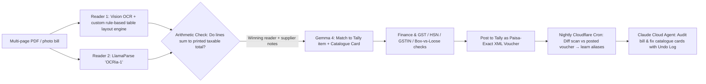
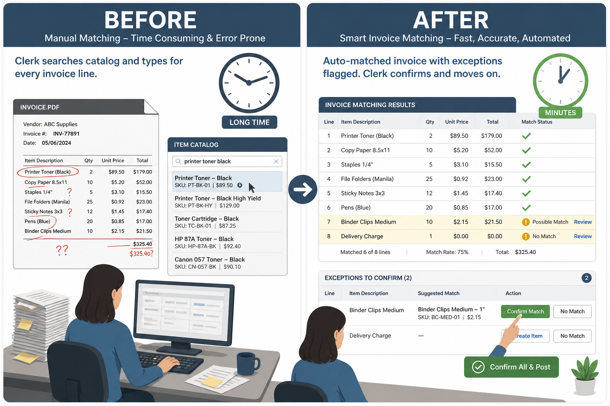
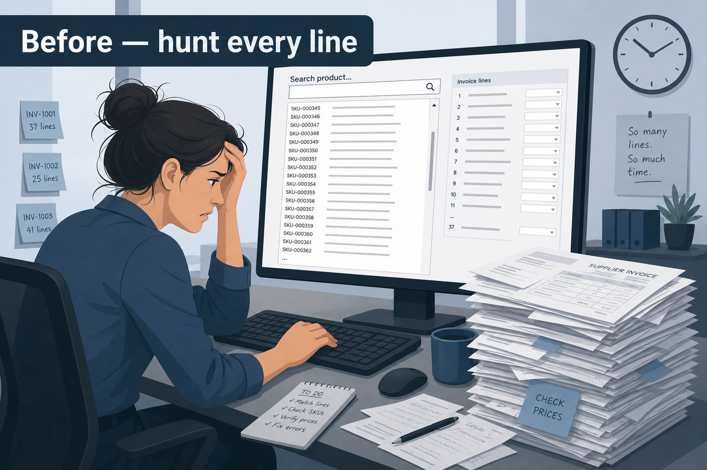
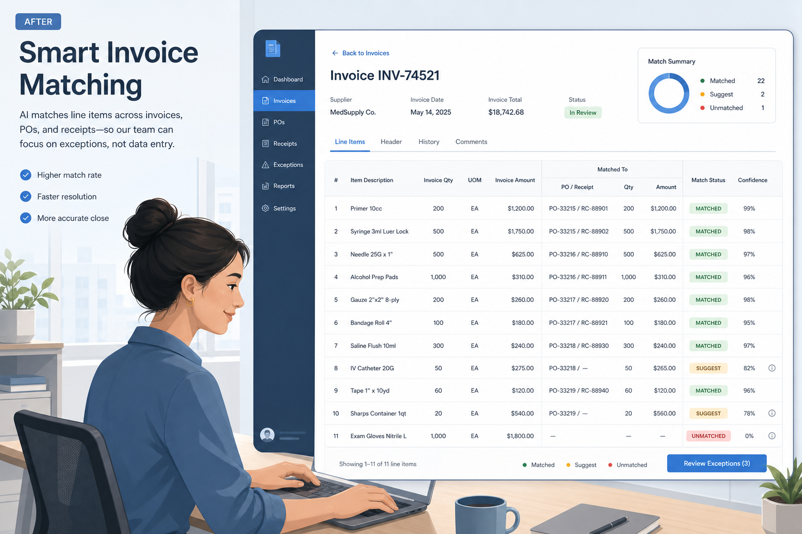
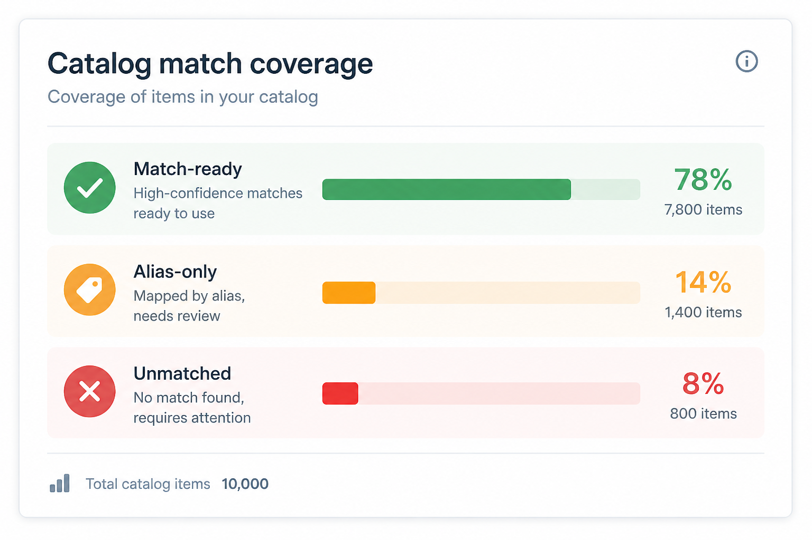

# Case Study 01: BillMiner Dual-Reader Invoice Scanner, Gemma 4 Matching & Self-Learning Catalogue

**Project:** **BillMiner** (XML-to-LLM operations & automated book keeping system built on top of Tally Prime, a desktop Legacy ERP)  
**Role:** Lead AI & Systems Engineer  
**One-liner:** Dual-reader OCR reconciled by arithmetic checks, open-weight **Gemma 4** item matching (**92% / 291 of 317 real supplier bills**), and a nightly self-learning loop that updates aliases and catalogue cards with reversible audit logs.

---

## 1. The Real-World Problem: Tally XML + Messy Multi-Page Supplier Bills

A dental-supplies distributor ran its entire business on **Tally Prime** (`XML over HTTP :9000`). Over years of manual entry by billing clerks, the item master had grown to **~13,000 stock-item names** (~9,600 sold and **3,256 never-billed dead names**) filled with typos, duplicates, and three different names for the same SKU.

Meanwhile, multi-page supplier purchase bills arrived as skewed photos or complex PDFs with:
- Tilted tables and scattered columns
- European/mixed number formatting (`1.234,56`)
- Quantity and rate printed in swapped columns
- Product names wrapping onto the next row
- Pack-size quirks specific to individual suppliers (e.g., *"this supplier prints a pack of 5 as 1"*)

---

## 2. Architecture: Dual Readers + Open-Weight Gemma 4 + Nightly Agent Loop

| Stage | What BillMiner Runs | Why It Works in Production |
| --- | --- | --- |
| **1. Parallel Dual Readers** | **Reader 1:** Google Vision OCR + custom rule-based table/column parser (tilted tables, swapped qty/rate, wrapped lines). **Reader 2:** LlamaParse (`OCRia-1`). | **Checks decide the winner:** Each reader's extracted lines must sum to the bill's printed taxable total. When the two disagree, the one whose math checks out wins. |
| **2. Per-Supplier Memory** | Applies remembered notes per supplier (e.g., pack-of-5 billed as 1). | Arithmetic is re-checked after applying notes so a stale or bad note can never corrupt a bill. |
| **3. Open-Weight Gemma 4 Matching** | Replaced expensive commercial LLM APIs with **Gemma 4** in production to match each bill line to *both* its Tally stock item and its structured catalogue card (variant). | Cuts per-bill inference cost and eliminates rate limits while keeping clerks unblocked (unknown lines get a temporary name and build catalogue cards in the background). |
| **4. Pre-Post Finance & Tax Gate** | Verifies line totals, GST slabs, HSN-code mismatches between the bill and Tally, supplier GSTIN, and box-vs-loose carton conversions. | Calculates per-line GST rounded half-up to the paisa before summing — matching Tally's exact tax math so Tally never rejects an XML voucher. |
| **5. Nightly Self-Learning & Claude Audit Agent** | Every evening, a **Cloudflare cron** diffs the raw scan against what was finally posted in Tally to learn aliases and supplier rules. Then a scheduled **Claude agent** reviews the bill and fixes catalogue cards. | Fragment guards block learning from broken text snippets, and every agent edit goes through **audited endpoints** with full before/after state and 1-click undo. |

---

## 3. Before → After (Clerk & Operations Impact)

### Before — Manual Tally Entry ("Type, search, hope")

1. Clerk reads a multi-page supplier bill with 20–80 lines of shorthand and pack codes.
2. Searches ~13,000 messy Tally names by memory; picks a duplicate or invents a new free-text name.
3. Skips batch/expiry or miscalculates box-vs-loose quantities.
4. Rounding differences between supplier bills and Tally GST slabs stall voucher entry.

### After — Dual-Reader Extract → Gemma 4 Match → Nightly Learning

1. Upload photo or multi-page PDF — **Vision Layout Reader + LlamaParse** extract lines and verify against the printed taxable total.
2. **Gemma 4** + local alias tables match each line to its Tally item and catalogue variant.
3. Lines with no Tally name receive a temporary name so the clerk is **never blocked**; catalogue cards build asynchronously.
4. **Process** posts the purchase voucher to Tally via the Windows desktop agent as paisa-exact XML.
5. That night, the **Cloudflare cron** and **Claude catalogue agent** learn from any clerk edits so the same string resolves at $0 model cost next time.

---

## 4. Rebuilding a ~13,000-Item Catalogue Under the "Nothing Is Lost" Rule

Without a clean catalogue, invoice matching has nothing reliable to land on. We restructured **~13,000 Tally item names** (~9,600 sold) into **Product Families → Variants (Catalogue Cards)**:

- **Rule 1 — Nothing from Tally is ever lost:** Every Tally name stays findable. Every catalogue change is a *move*, never a delete, verified against the full set of Tally names before and after each batch.
- **Rule 2 — Dead names isolated on our side:** **3,256 never-billed Tally names** were audited and marked in our database without touching the accountants' Tally ledger.
- **Rule 3 — Multi-source research + Staff Micro-Questions:**
  - Manufacturer catalogues serve as ground truth.
  - A **Brave Search + LLM web research agent** cross-checks missing attributes across multiple web sources.
  - Questions requiring physical shelf knowledge become quick **1-tap mobile questions** for staff — settling **~22% of catalogue gaps**.

---

## 5. Measured Production Results

| Metric | Measured Result |
| --- | --- |
| **End-to-End Purchase Bill Accuracy** | **92% (291 of 317 real supplier bills)** read and matched correctly end-to-end |
| **Posted Voucher Regression Check** | **12 of 12 posted bills** matched posted totals and line counts to the paisa |
| **Catalogue Reconstruction Scope** | **~13,000 Tally names** (~9,600 sold; **3,256 dead names** audited; **0 lost keys**) |
| **Catalogue Gaps Solved by Staff UI** | **~22%** resolved via mobile staff micro-questions |
| **Production Matching Model** | Migrated from commercial LLM API to open-weight **Gemma 4** |
