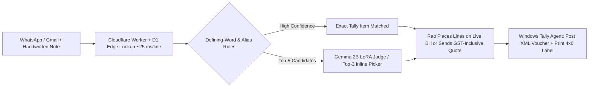
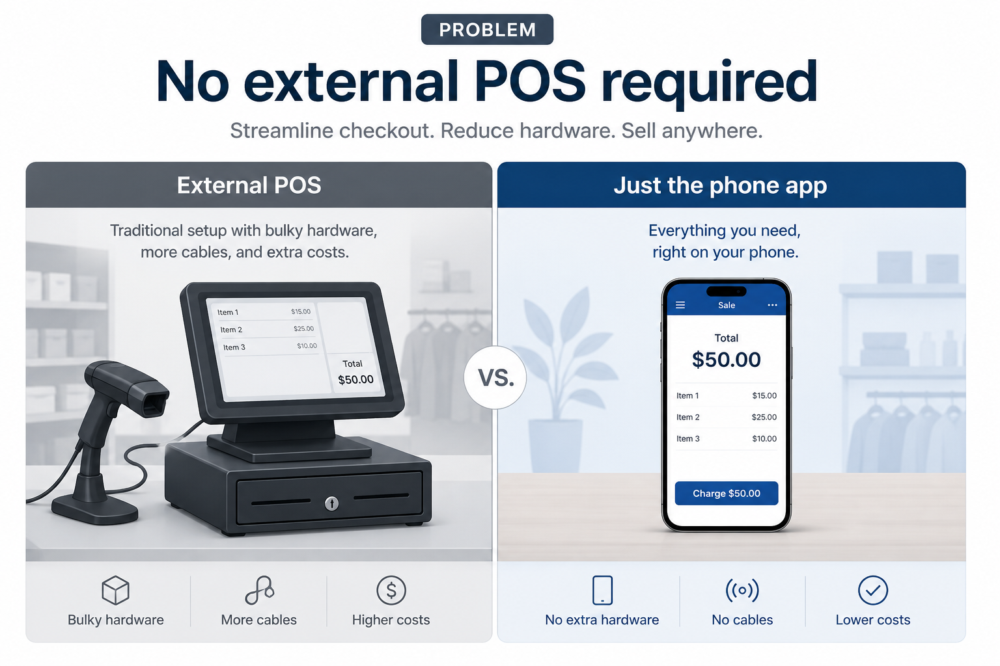
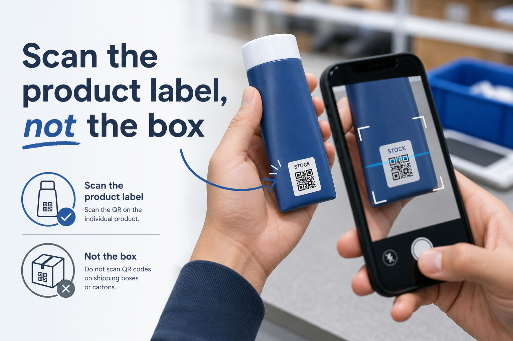
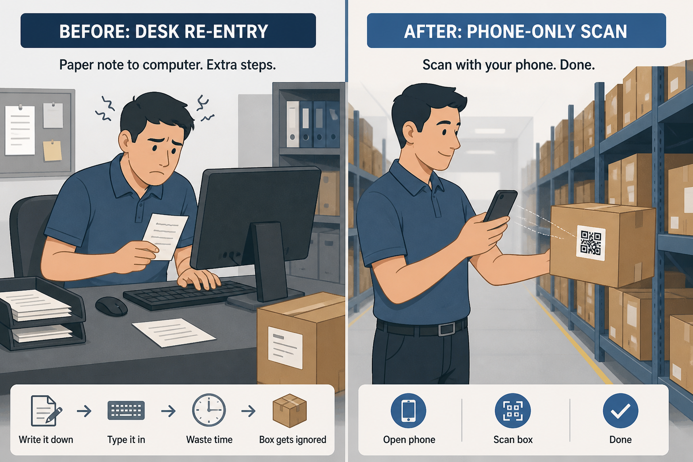

# Case Study 02: Edge Seller Detect (~25 ms/line), "Rao" Invoicing Agent & Mobile Unit Scan

**Product:** **BillMiner** (XML-to-LLM operations platform on top of Tally Prime)  
**Role:** Founder / Lead AI & Full-Stack Engineer  
**One-liner:** Turn customer WhatsApp messages, Gmail enquiries, handwritten lists, and mobile unit-label scans into exact Tally invoice lines in **~25 ms/line at the edge**, backed by **Rao (Retrieval Augmented Outvoicing)** and a fine-tuned **Gemma 2B LoRA** candidate judge.

---

## 1. Three Ways Orders Enter BillMiner (All Hitting the Same ~25 ms Edge Graph)

In a busy wholesale distribution business, orders arrive through three very different channels:
1. **Unstructured Customer Messages (WhatsApp, Gmail, Handwritten Notes):** Doctors send shorthand messages or photos of handwritten lists asking for prices or placing orders.
2. **Clerk Assisted Invoicing ("Rao" Inside the Invoice Screen):** Clerks paste or photograph an order directly inside the billing workspace and want lines placed straight onto the active bill with inline variant pickers.
3. **Floor / Counter Unit Scanning (Scan → Invoice → Stock):** Staff scan individual product unit labels with a phone camera (no external POS terminal or barcode gun) to build an invoice and draw down stock lots.

Underneath all three surfaces sits the same **Cloudflare Workers + D1 (SQLite) + KV** edge lookup layer and the ~13,000-item **BillMiner** catalogue.

---

## 2. Seller Detect (~25 ms/line at the Edge) & Open-Weight Gemma 2B LoRA Judge

### How Seller Detect Achieves ~25 ms/line and High Accuracy:
- **Edge Execution (Cloudflare Workers + D1):** Voucher history, stock items, learned aliases, and catalogue cards live at the edge in Cloudflare D1 and KV, answering lookups in **~25 ms per line** at **$0 LLM token cost**.
- **"Defining Words" Steering:** Each Tally item stores a canonical product noun ("defining word") that steers candidate retrieval and prevents cross-category mismatches (e.g., matching a bur instead of a composite of the same code).
- **Measured Accuracy on Real Customer Enquiries:**
  - **WhatsApp Orders:** **81% Top-1** accuracy and **98% Top-3** accuracy.
  - **Gmail Quote Enquiries:** **75% Top-1** accuracy and **89% Top-3** accuracy.
  - **Never Guesses Blindly:** When confidence is below threshold, Seller Detect presents the **top 3 options** in an inline picker instead of silently picking the wrong item.
- **Small-Model Judge (Gemma 2B LoRA — In Progress):** Built the training dataset and fine-tuning job for a compact **Gemma 2B LoRA** model dedicated to selecting the best match among the top 5 rule candidates — keeping inference fast and open-weight.

---

## 3. "Rao": Retrieval Augmented Outvoicing (In-Workspace AI Agent)

Instead of making clerks copy-paste between a chatbot and the billing screen, I built **Rao (Retrieval Augmented Outvoicing)** directly inside the invoice workspace:

- **Order-to-Bill in One Action:** Paste text or snap a photo of a customer's order and Rao puts the matched lines **straight onto the invoice**.
- **Transparent Provenance + Inline Variant Picker:** Above each matched Tally item name, Rao displays the **customer's own original words**, paired with a 1-click inline picker showing usual sizes and shades first.
- **Instant Price Replies (Zero Bill Side-Effects):** When a customer is just asking for rates, Rao turns a photo or text enquiry into a plain-text quotation (**highest billed price including GST**, plus in-stock status) without touching the active bill.
- **Saved Chat History:** Persistent conversation history with New-Chat and History controls for multi-turn order revisions.

---

## 4. Mobile Floor Capture: Scan the Product Unit, Not the Shipping Carton

When orders are picked on the warehouse floor, clerks use the phone camera directly — **no external POS hardware and no barcode gun**.

### Why Unit-Level Scanning + Box-vs-Loose Rules Matter:
- **Scan the Product, Not the Master Box:** QR stickers live on the sellable unit pack, preventing clerks from accidentally billing a 10-pack carton as 1 piece (or vice versa).
- **Box-or-Loose Workspace Support:** Every invoice line in BillMiner supports whole-box or loose-piece conversion backed by deterministic pack-size math.
- **Non-Blocking Tally Agent & 4×6 Labels:** On **Process**, the invoice posts to Tally Prime as paisa-exact XML via the Windows desktop agent queue (which also prints **4×6 thermal shipping labels** and buffers vouchers safely if Tally is offline).

---

## 5. Measured Impact Summary

| Capability | Measured / Production Result |
| --- | --- |
| **Edge Lookup Latency (Cloudflare Worker + D1)** | **~25 ms per line** ($0 LLM token cost on alias/rule hits) |
| **WhatsApp Order Matching Accuracy** | **81% Top-1 · 98% Top-3** |
| **Gmail Enquiry Matching Accuracy** | **75% Top-1 · 89% Top-3** |
| **In-Screen AI Assistant ("Rao")** | Direct line insertion onto live bills + GST-inclusive plain-text quote replies |
| **Tally Sync & Tax Integrity** | Compact TDL jobs (**≤500 KB**), isolated date variables, **paisa-exact half-up GST rounding** |
