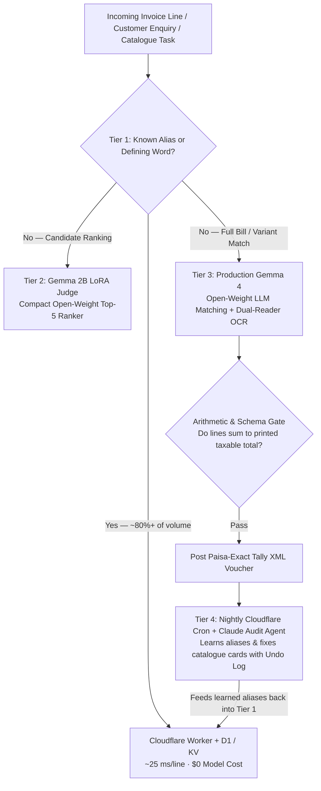

# Case Study 03: Open-Weight LLMs (Gemma 4 & LoRA), Autonomous Agents & Radical Cost Engineering

**Project:** **BillMiner** (XML-to-LLM operations & automated book keeping system built on top of Tally Prime, a desktop Legacy ERP)  
**Role:** AI Systems & Agent Engineer  
**One-liner:** How I replaced expensive commercial LLM APIs with **open-weight Gemma 4**, built a **Gemma 2B LoRA** ranking judge, offloaded lookups to **~25 ms edge databases**, and engineered **4 bounded AI agents** with arithmetic and reversible audit guardrails.

---

## 1. Why Frontier API Wrappers Fail in High-Volume Distribution Ops

When I first prototyped **BillMiner** to automate supplier bill ingestion, ~13,000-item catalogue normalization, and WhatsApp/email order matching, calling large commercial LLM APIs on every document and line item proved unsustainable for three reasons:
1. **Unpredictable Per-Document Cost:** A single multi-page supplier invoice can contain 50–80 line items. Calling a frontier LLM for every line across hundreds of bills — and re-running test suites during development — created steep API bills.
2. **Latency & Rate Limits:** Waiting 5–15 seconds per LLM call blocked billing clerks and slowed down iterative testing across the 13,000-item catalogue.
3. **Silent Hallucinations Without Hard Checks:** Models occasionally invented product variants that manufacturers didn't make or misread tilted table columns when not constrained by arithmetic checks.

To make BillMiner fast, economical, and trustworthy in daily production, I re-architected the platform around **open-weight models**, **$0-token edge routing**, and **bounded, reversible AI agents**.

---

## 2. The 4-Tier Cost & Latency Architecture

| Tier | Workload | Model / Engine | Cost & Speed Impact |
| --- | --- | --- | --- |
| **Tier 1: Edge Database Lookup** | Customer WhatsApp/Gmail orders, known supplier aliases, any-word-order search | **Cloudflare Workers + D1 (SQLite) + KV** | **~25 ms per line · $0 token cost** |
| **Tier 2: Compact LoRA Ranker** | Choosing the exact Tally SKU among the top 5 rule-generated candidates | **Gemma 2B LoRA** (dataset & training pipeline built; in progress) | Order-of-magnitude smaller & faster than general-purpose LLMs |
| **Tier 3: Open-Weight Production LLM** | Matching multi-page purchase bill lines to Tally items and catalogue variants | **Gemma 4** (replaced commercial LLM in production) | Eliminates commercial per-token charges & rate limits; **92% (291/317)** real bills accurate |
| **Tier 4: Scheduled Cloud Audit Agents** | Nightly post-posting catalogue card repair & multi-source web verification | **Cloudflare Cron + Claude Cloud Routine + Brave Search API** | Runs asynchronously off the critical path; writes learned aliases back into Tier 1 so future hits cost **$0** |

**Bonus — Storefront Imagery at ~$0.007 per Photo:**  
Instead of using expensive generative image diffusion APIs (which also risk altering medical/dental packaging labels), I built a programmatic photo pipeline that transforms real product photos into a single house style for **~$0.007 per image**, prioritizing the 85 product pages that drive 70% of sales.

---

## 3. Designing 4 Production AI Agents That Can't Corrupt the Books

In an accounting-linked system, an AI agent can never have unchecked write access to the ledger. Every agent in **BillMiner** operates inside strict deterministic guardrails:

### Agent 1: "Rao" (Retrieval Augmented Outvoicing Agent)
- **What it does:** Lives inside the invoice screen. Clerks paste or photograph a customer order; Rao maps lines onto the active bill, shows the customer's exact words above each Tally name, and surfaces an inline variant picker. In price-reply mode, it generates a plain-text GST-inclusive quotation without touching the bill.
- **Guardrail:** Never auto-commits a voucher; when Seller Detect confidence is low, it surfaces the top 3 candidates instead of guessing.

### Agent 2: Nightly Self-Learning & Claude Catalogue-Repair Agent
- **What it does:** Each night, a Cloudflare cron job compares raw scanned bill text against the final voucher posted in Tally to learn supplier aliases and pack-conversion rules. Next, a scheduled **Claude cloud agent** reviews the posted bill and repairs catalogue cards.
- **Guardrail:**
  1. **Fragment Guards:** Prevents the cron learner from learning noisy OCR substrings as aliases.
  2. **Audited, Reversible Endpoints:** Every edit made by the Claude routine is written through audited endpoints that log the full **before and after state** with 1-click undo.

### Agent 3: Multi-Source Catalogue Research Agent + Staff Micro-Questions
- **What it does:** Built a clean family/variant catalogue out of **~13,000 messy Tally names** (~9,600 sold; **3,256 never-billed dead names audited**). Uses manufacturer PDFs plus **Brave Search API + LLM reading** to cross-verify product specs across multiple sources.
- **Guardrail:**
  1. **"Nothing Is Lost" Rule:** Every catalogue update is a *move*, never a delete, verified against the full set of Tally names before and after each batch.
  2. **Human Micro-Loop:** Questions that require physical shelf knowledge are routed to a mobile staff page as quick 1-tap questions — settling **~22% of catalogue gaps** without hallucinations.

### Agent 4: Read-Only Gmail Enquiry & Draft Worker
- **What it does:** Monitors the shared Gmail inbox, extracts customer product enquiries, runs Seller Detect against Cloudflare D1 (`75% top-1, 89% top-3`), and prepares structured quotation drafts.
- **Guardrail:** Strictly **read-only and draft-only** — it never sends an email without human approval.

---

## 4. Key Takeaways for AI Engineering Teams

1. **Self-learning loops turn LLM calls into $0 database lookups:** Every time a clerk processes a bill and the nightly cron learns that supplier's alias, tomorrow's identical line resolves in **~25 ms on Cloudflare D1** without calling an LLM at all.
2. **Open-weight models (`Gemma 4` + `Gemma 2B LoRA`) unlock fearless iteration:** Moving off expensive per-token APIs meant we could run full 317-bill regression benchmarks and 13,000-item catalogue sweeps freely during development.
3. **Deterministic math is the ultimate LLM judge:** Running two OCR readers in parallel and checking which one sums to the bill's printed taxable total beats any prompt-engineering trick (**291/317 real bills correct; 12/12 regression match**).
